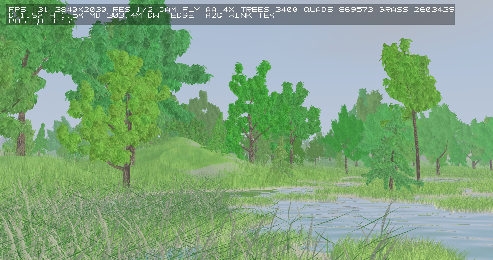
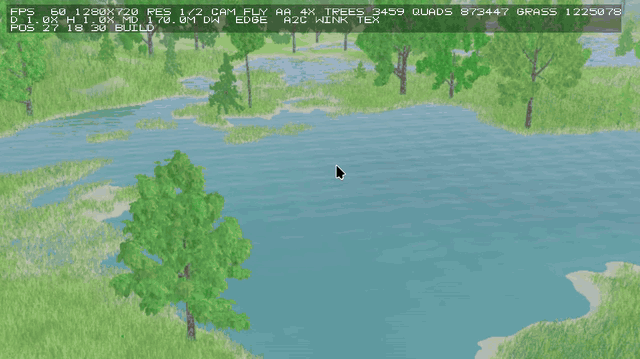
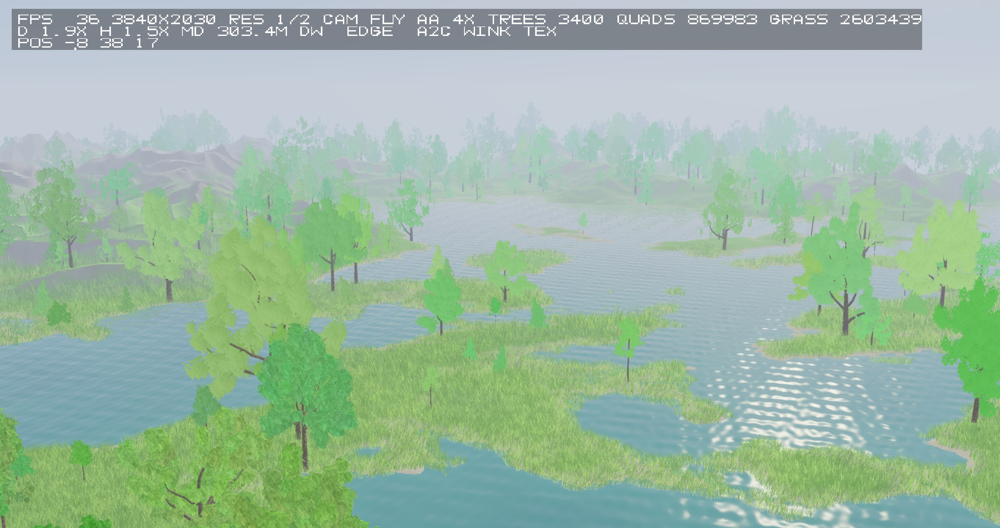

# 64kDemo — a procedurally generated woodland in C + OpenGL

[Deutsch](README.md) · English

A patch of landscape with trees, grass and reeds, generated entirely
procedurally at runtime: no models, no texture files, no asset pipeline.
It started as a 64 kB demo (hence the name); the size budget is no longer a
goal — the interesting part is the procedural generation.

The current state is a **work in progress**, not a release: view distances,
LOD transitions and performance are still being worked on.

The code was written together with a local language model. Which model, in two
phases across how many sessions, and why the `protocol*.txt` files are part of
this repository: [ENTSTEHUNG.en.md](ENTSTEHUNG.en.md) (German:
[ENTSTEHUNG.md](ENTSTEHUNG.md)).

## Pictures



Shot at eye height, 2026-10-24. In the foreground the trees are drawn with
individual leaves; from the middle of the frame onward the same woods use cluster
quads and crown hulls — the switch is keyed to how large a leaf would appear on
screen, not to fixed distances in metres. HUD: 3400 trees, 869,573 canopy quads,
2,603,439 grass blades, 3840x2030 window at half internal resolution, 4x MSAA,
31 fps on the host machine.



A camera move over the same world: from the water in between the trees.
80 frames in 8 seconds, captured from a 1280x720 window; the HUD frame rate
stays between 50 and 61 fps throughout.



The same world from above: shallow water with reed belts, forest out to the fog
limit — beyond that nothing is generated at all. HUD: 3400 trees,
869,983 canopy quads, 36 fps.

## What is in here

* **Terrain**: procedural height field, raymarched in the colour pass
  (height-field marching instead of a mesh), fog sharing the same function as
  the objects.
* **Trees**: the generator is a C port of
  [EZ-Tree](https://github.com/dgreenheck/ez-tree) (MIT, see `QUELLEN.md`),
  with oak / ash / aspen / pine presets. Twigs, axes, branching, radii and leaf
  clusters all come from a seed — same seed, same tree.
* **Three foliage representations** per tree, chosen by projected screen size:
  individual leaves → cluster cards → crown hull (a cylindrical raster built
  from the cluster positions, with real gaps where there are no leaves).
  Handovers run per tree through a two-buffer composite, not through
  alpha blending.
* **Grass and reeds**: instanced blades, plus a separate reed pass with a
  density field and shoreline detection.
* **Wind**: one gust field used identically by branches, leaves, cards, hull and
  grass.
* **No linking against OpenGL/X11**: everything is bound at runtime through
  `dlopen`, so it compiles and runs without any -dev packages installed.

## Building and running

Requirements: `gcc` (c11); at runtime `libX11.so.6` and `libGL.so.1` with an
OpenGL 4.3 context (NVIDIA or Mesa are fine). The needed headers live in
`third_party/include`.

```sh
make                      # builds bin/64kdemo, generates src/shaders_gen.c
./bin/64kdemo 1920 1080   # window size; defaults to 1280x720
```

`make` also copies the binary to `/media/sf_Quarantine/64kDemo` (a VM shared
folder). Where that path does not exist or is not writable you only get a
warning; the build itself is unaffected.

### Keys

```
mouse=look  WASD=fly  Space/X=up/down  Shift=sprint
O=orbit  R=reset  1/2/3=resolution scale  T=wireframe  P=screenshot  M=MSAA  H=HUD  Q/Esc=quit
4=leaves only  5=cluster cards only  8=crown hull only  7=all foliage layers
0=composite (LOD handover) off/on
```

### Environment variables

There are roughly 90 measurement and diagnostics switches
(`grep -o 'getenv("DEMO_[A-Z]*")' src/main.c | sort -u`). The useful ones:

| Variable | Effect |
|---|---|
| `DEMO_CAM="x z pitch yaw"` | place the camera (height follows the terrain) |
| `DEMO_WALK="x 0"` | let the camera travel (movement test) |
| `DEMO_TREEGEN=ez\|alt` | tree generator: EZ-Tree port or the older own version |
| `DEMO_EZPRESET=0..3`, `DEMO_EZSPREAD=` | tree species and growth form (3 = conifer) |
| `DEMO_BUILDTIME=1` | measure tree build and upload times |
| `DEMO_LODTEST="d1 d2 step"` | one tree and nothing else, camera approaching in fixed steps |
| `DEMO_LAYERS="leaf\|card\|hull"` | show a single foliage layer |
| `DEMO_COMP=0/1` | two-buffer handover off/on |
| `DEMO_EXIT=1 [DEMO_EXITFRAME=n]` | quit once build+upload finished (measurement runs) |
| `DEMO_SHOTFRAME=n` | write an image after n frames |

## Tests

```sh
make test-lod     # the LOD core without GL: bands, continuity, existence margins  (~140,000 checks)
make test-tree    # tree building without GL: identical geometry at any build distance
tools/selftest.sh # runs several configurations: no GL errors, no buffer-cap hits,
                  # no skipped trees, two identical runs bit-for-bit equal
```

The selftest is built for reproducibility, not for judging looks: it compares two
runs of the same configuration pixel by pixel. How it looks is for a human to
decide.

## Repository

```
src/main.c        window, GLX, draw order, all passes, HUD, screenshots
src/shaders/      GLSL (turned into src/shaders_gen.c by tools/gen_shaders.sh)
src/trees_cpu.c   tree generator (EZ-Tree port), clusters, crown hull
src/tree_lod.c    switch distance from projected size, bands, weights — pure, no GL
src/grass_cpu.c   blades, density field, far texture handover
src/reed_cpu.c    reeds (shore zones)
src/terrain_cpu.c height field, fog
tools/            shader generation, GL-free host tests, selftest.sh
STATUS.md         work log: every round with its measurements and mistakes (German)
ENTSTEHUNG.en.md  background: which models, two phases, ten sessions and then one
protocol*.txt     agent session protocols (how this came to be, see QUELLEN.md)
```

## Current state (short version)

The forest edge reaches as far as the fog does (~450 m); trees are generated in a
worker thread and uploaded in slices. The handovers between foliage layers work
through the per-tree composite; the crown hull and an even build edge (whole
rings of trees no longer disappearing during camera movement) are still open.
Needles instead of broad leaves on conifers, leaf styles, and the wind model
(bending instead of shifting at branch joints) are on the list.

## License and sources

MIT, see `LICENSE`. `QUELLEN.md` (German) lists what the code builds on — the tree
generator is a port of EZ-Tree (Daniel Greenheck, MIT), which is why this
project is MIT as well.
